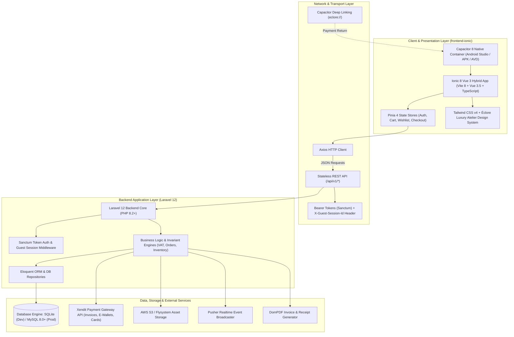
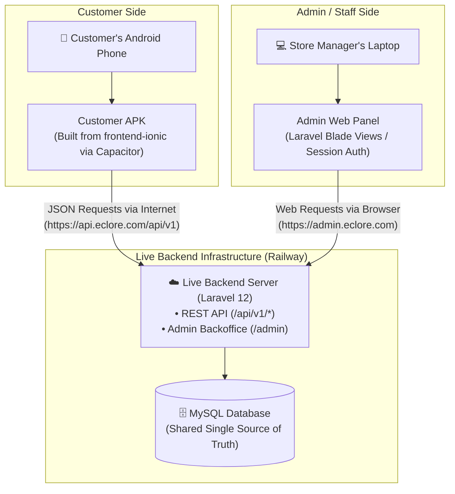

# Éclore Architecture & Migration Tech Stack Specification

**Project:** Éclore Luxury Jewellery E-Commerce Platform  
**Target Architecture:** Decoupled Architecture (Laravel 12 REST API + Ionic 8 Vue 3 Hybrid Mobile/PWA)  
**Primary Deployment Platform:** Android Application (via Capacitor 8 & Android Studio) with Web/PWA Fallback  
**Document Classification:** Technical Architecture & Technology Stack Specification  
**Version:** 1.0.0  

---

## 1. Executive Summary & Architecture Philosophy

The Éclore migration transitions an existing monolithic e-commerce application (Laravel 12 Blade + Alpine.js + vanilla JS) into an enterprise-grade, API-first architecture featuring an **Ionic Vue 3** mobile-first client powered by a robust **Laravel 12 REST API**.



### Core Architecture Invariants
1. **Laravel as Authoritative Single Source of Truth:** Business invariants (pricing, 12% Philippine VAT, inventory deductions, order lifecycles, and RBAC permissions) execute solely on the Laravel backend.
2. **Stateless API Decoupling:** Client communication is purely stateless over `/api/v1/*` using Laravel Sanctum Bearer tokens for authenticated users and validated `X-Guest-Session-Id` headers for anonymous shoppers.
3. **Hardware & Native Integration:** Mobile interactions leverage native hardware via Capacitor (biometric safe areas, hardware back-button interceptors, deep linking for payment callbacks).
4. **1:1 Visual Parity:** Preserves the atelier luxury brand identity (Playfair Display, Azeret Mono, Champagne Gold `#B6965D`, Warm Cream `#F3EFE7`, Deep Ink `#1A1A1A`).

### 1.1 End-to-End System Access Flow (Customer APK vs. Admin Web Panel)

The following flowchart illustrates how the **Customer APK** and the **Store Manager's Admin Web Panel** communicate with the shared live backend server and database:



---

## 2. Frontend & Mobile Client Technology Stack

The client application lives in `frontend-ionic/` and provides a cross-platform luxury storefront.

| Layer / Concern | Technology | Version | Purpose & Rationale |
| :--- | :--- | :--- | :--- |
| **Mobile UI Framework** | **Ionic Framework Vue** (`@ionic/vue`) | `^9.0.7` | Provides accessible mobile UI primitives (`ion-page`, `ion-content`, `ion-modal`, `ion-toast`, `ion-refresher`) that adapt naturally to Android and iOS guidelines. |
| **Mobile Router** | **Ionic Vue Router** (`@ionic/vue-router`) | `^9.0.7` | Integrates with Vue Router 4 to maintain mobile page-transition animations and stack history. |
| **UI Library / Core** | **Vue.js 3** (`vue`) | `^3.5.42` | Composition API (`<script setup lang="ts">`) and Single File Components (SFCs), matching existing Alpine.js mental models. |
| **Type System** | **TypeScript** (`typescript`) | `~6.0.2` | Strong static typing across all models, DTOs, API payloads, and Pinia stores. |
| **Type Checker** | **Vue TSC** (`vue-tsc`) | `^3.3.11` | Build-time TypeScript type checking for Vue SFCs. |
| **Build Engine & Bundler** | **Vite** (`vite`) | `^8.3.0` | Ultra-fast HMR and optimized production bundling with `@vitejs/plugin-vue` (`^6.0.8`). |
| **State Management** | **Pinia** (`pinia`) | `^4.0.3` | Modular, reactive, type-safe state management (`useAuthStore`, `useCartStore`, `useWishlistStore`, `useCheckoutStore`). |
| **Styling & CSS** | **Tailwind CSS v4** (`tailwindcss`) | `^4.3.3` | High-performance CSS engine configured via `@tailwindcss/vite` (`^4.3.3`) alongside luxury design tokens. |
| **Mobile Runtime Container** | **Capacitor Core** (`@capacitor/core`) | `^8.5.3` | Bridge between modern web technology and native mobile OS APIs. |
| **Android Native Target** | **Capacitor Android** (`@capacitor/android`) | `^8.5.3` | Native Android Gradle project container opened and debugged in Android Studio. |
| **CLI Tooling** | **Capacitor CLI** (`@capacitor/cli`) | `^8.5.3` | Command-line management for mobile platforms (`npx cap sync`, `npx cap open android`). |
| **HTTP Client** | **Axios** (`axios`) | `^1.20.0` | Promise-based HTTP client with request/response interceptors for Bearer tokens and guest headers. |
| **Iconography** | **Ionicons** (`ionicons`) + **Lucide** (`lucide-vue-next`) | `^8.1.0` / `^1.0.0` | Clean luxury iconography for actions, luxury bag badges, navigation, and feedback states. |

### Capacitor Native Plugins

```
@capacitor/app (^8.1.2)           -> App lifecycle management, hardware back-button listener, deep links (eclore://)
@capacitor/browser (^8.0.5)       -> In-app secure browser handling external Xendit payment checkout redirections
@capacitor/preferences (^8.0.1)   -> Persistent, secure key-value storage for auth tokens and guest session IDs
@capacitor/status-bar (^8.0.4)     -> Native Android status bar color and dark/light overlay control
```

---

## 3. Backend & API Services Technology Stack

The backend application lives in `jewellery-store-ecommerce/` and acts as the system of record and API engine.

| Layer / Concern | Technology | Version | Purpose & Rationale |
| :--- | :--- | :--- | :--- |
| **Backend Framework** | **Laravel Framework** (`laravel/framework`) | `^12.0` | Latest LTS-ready Laravel engine providing routing, validation, Eloquent, queues, and container injection. |
| **Runtime Language** | **PHP** | `^8.2` | Modern PHP featuring typed properties, match expressions, and readonly classes. |
| **API Authentication** | **Laravel Sanctum** (`laravel/sanctum`) | `^4.3` | Lightweight token authentication issuing Bearer Personal Access Tokens (`HasApiTokens`) for mobile clients. |
| **Guest Identification** | **HandleGuestSessionHeader** (Middleware) | Custom | Resolves anonymous users via `X-Guest-Session-Id` header and handles post-login guest data merging. |
| **Database ORM** | **Eloquent ORM & Doctrine DBAL** (`doctrine/dbal`) | `^4.3` | Active record ORM with support for database introspection and column alterations. |
| **Primary Database (Dev)** | **SQLite** (`database.sqlite`) | Built-in | Zero-configuration local database pre-seeded with 100 products, 30 categories, and 150 users. |
| **Primary Database (Prod)**| **MySQL / MariaDB** | `8.0+` | Scalable ACID relational database for staging and production environments. |
| **Payment Gateway** | **Xendit PHP Integration** | REST v2 | Philippine payment processing (GCash, Maya, GrabPay, Credit Cards) with webhook signatures and locks. |
| **Auxiliary Payment** | **Adyen PHP API Library** (`adyen/php-api-library`)| `^28.2` | Global payment alternative and enterprise acquiring gateway. |
| **Document Engine** | **Laravel DomPDF** (`barryvdh/laravel-dompdf`) | `^3.1` | Automated generation of downloadable PDF order receipts and invoices. |
| **Object Storage** | **Flysystem AWS S3** (`league/flysystem-aws-s3-v3`) | `^3.30` | Cloud media storage for high-resolution jewellery editorial assets. |
| **Realtime WebSockets** | **Pusher PHP Server** (`pusher/pusher-php-server`) | `^7.2` | Push notifications and live order fulfillment status updates. |
| **In-Memory Cache/Queue** | **Predis** (`predis/predis`) | `^3.2` | High-throughput Redis client for background queues and session caching. |
| **Social Authentication** | **Laravel Socialite** (`laravel/socialite`) | `^5.23` | OAuth provider for Google authentication flows. |

---

## 4. Development, Testing & Quality Assurance Stack

| Tool / Library | Version | Usage Scope | Function |
| :--- | :--- | :--- | :--- |
| **PHPUnit** (`phpunit/phpunit`) | `^11.5.3` | Backend Testing | Comprehensive unit and feature test suite (`Stage0FixesTest`, `Stage1ApiTest`, `Stage4CartWishlistMigrationTest`, `Stage5CheckoutTest`). |
| **Mockery** (`mockery/mockery`) | `^1.6` | Backend Testing | Object mocking framework for external payment APIs and file storage services. |
| **Laravel Pint** (`laravel/pint`) | `^1.24` | Code Quality | Opinionated PHP code style fixer built on PHP-CS-Fixer for clean, PSR-12 compliant code. |
| **Laravel Pail** (`laravel/pail`) | `^1.2.2` | Realtime Logging | Live CLI log streaming directly in the terminal during development. |
| **Laravel Sail** (`laravel/sail`) | `^1.41` | Containerization | Docker development environment for local MySQL, Redis, and Mailpit testing. |
| **Android Studio** | Ladybug / Koala | Native Mobile | Native compilation, Android SDK 34/35 target, emulator testing, and release signing. |
| **Android Virtual Device (AVD)**| Android 14/15 (API 34/35)| Mobile Emulation | Validates mobile UX, touch target sizes, and `10.0.2.2` network loopback. |
| **Android Debug Bridge (ADB)** | Platform Tools | Device Testing | USB debugging and reverse proxy routing (`adb reverse tcp:8000 tcp:8000`). |

---

## 5. Network Topology & Environment Routing

| Execution Environment | API Base URL | Authentication Storage | Network Behavior & Configuration |
| :--- | :--- | :--- | :--- |
| **Android Emulator (AVD)** | `http://10.0.2.2:8000/api/v1` | `@capacitor/preferences` | Maps to the development workstation host via loopback alias `10.0.2.2`. Cleartext HTTP enabled in `AndroidManifest.xml`. |
| **Physical Android Device (USB)** | `http://localhost:8000/api/v1` | `@capacitor/preferences` | Uses `adb reverse tcp:8000 tcp:8000` to bind phone port 8000 to the dev server over USB. |
| **Physical Android Device (Wi-Fi)**| `http://192.168.x.x:8000/api/v1` | `@capacitor/preferences` | Communicates over local wireless LAN. Laravel server bound to `--host=0.0.0.0`. |
| **Browser / PWA Local** | `http://127.0.0.1:8000/api/v1` | `localStorage` + Cookies | Direct localhost requests with CORS headers configured in `config/cors.php`. |
| **Production Cloud** | `https://api.eclore.com/api/v1` | Encrypted Keystore | Production HTTPS with strict TLS 1.3 and signed certificates. |

---

## 6. Security & Data Protection Standards

1. **Bearer Token Lifetime & Rotation:** Sanctum tokens are generated with granular abilities (`customer:storefront`) and stored securely using `@capacitor/preferences` on Android devices.
2. **Pessimistic Concurrency & Stock Locks:** High-value inventory transitions utilize `lockForUpdate()` database locks to prevent race conditions during concurrent checkouts.
3. **Philippine Tax & VAT Calculations:** 12% Value Added Tax is calculated and verified server-side on net taxable totals before generating external payment invoices.
4. **Deep-Link Intent Verification:** The custom URL scheme `eclore://` processes checkout status returns (`eclore://checkout/success`, `eclore://checkout/cancel`) with backend transaction reconciliation before marking orders as paid.
5. **Zero Secret Leakage:** Cart and checkout error handlers sanitize all response payloads to avoid exposing cookies, tokens, or internal stack traces.

---

## 7. Migration Status & Roadmap Alignment

| Phase | Milestone Name | Tech Stack Implemented | Status |
| :--- | :--- | :--- | :--- |
| **Phase 0** | Schema & Database Remediation | SQLite / MySQL driver abstraction, Seeders, Eloquent models | **Completed** |
| **Phase 1** | API Normalization & Security | Laravel Sanctum, CORS, Versioned `/api/v1/*` routes | **Completed** |
| **Phase 2** | Ionic Shell & Luxury Design System | Ionic 8, Vue 3, Tailwind v4, Capacitor 8, Pinia, Axios | **Completed** |
| **Phase 3** | Product Catalog, Filters & PDP | Vue 3 SFCs, Faceted filter drawer, Gallery lightbox | **Completed** |
| **Phase 4** | Shopping Bag & Post-Auth Migration | Pinia Cart store, `X-Guest-Session-Id`, Guest-to-User sync | **Completed** |
| **Phase 5** | Checkout, PSGC & Xendit Payments | PSGC API, Xendit API, Capacitor Deep Links, Invoices | **Completed** |
| **Phase 6** | Customer Dashboard, Orders & RMA | Pinia Account store, Order tracking, Return workflows | **Completed** |
| **Phase 7** | Editorial Journal, CMS & Boutiques | Rich content components, Boutique maps, Booking flows | *Planned* |
| **Phase 8** | Final QA, Security & Cutover | End-to-end integration tests, APK build, Staged cutover | *Planned* |
